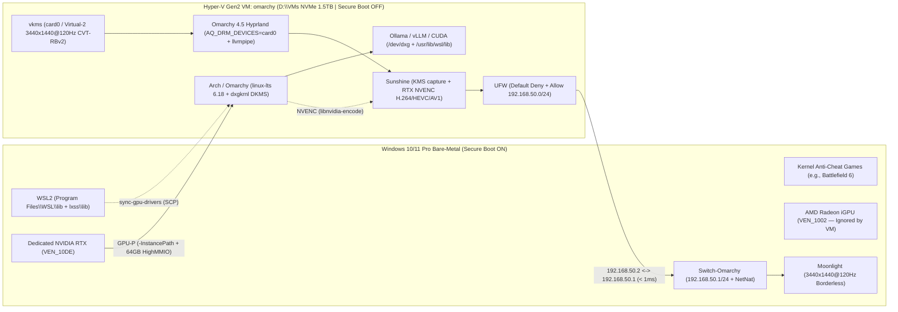

# omarchy-hyperv

**Run [Omarchy](https://omarchy.org) (Arch Linux + Hyprland) inside Windows Hyper-V with NVIDIA GPU Paravirtualization (GPU-P), full CUDA support, WSL2 coexistence, and native-feeling 2K Ultrawide streaming via Sunshine + Moonlight — while keeping Windows bare-metal with Secure Boot enabled for kernel-level anti-cheat games.**

> **Battle-tested hardware:** Windows 10/11 Pro bare-metal (Secure Boot ON) · AMD Ryzen 9 9950X (`16 vCPUs` allocated) · 96 GB RAM (Dynamic Memory `16 GB` startup / `4 GB` min / `64 GB` max) · NVIDIA GeForce RTX 5070 Ti (`VEN_10DE&DEV_2C05`, CUDA 13.3, `nvmdi.inf`, `64 GB` HighMMIO) with integrated AMD Radeon iGPU (`VEN_1002`) strictly excluded · Dedicated NVMe `D:\` (`1.5 TB` dynamic VHDX). Verified running *Battlefield 6* (EA Javelin anti-cheat) concurrently while the Omarchy VM accesses the RTX via GPU-P.

---

## Why This Exists

Dual-booting breaks flow, and passing through a full GPU on Linux hosts breaks Windows kernel-level anti-cheat (EA Javelin, Vanguard, etc.). **omarchy-hyperv** gives you the best of both worlds:

- **Windows stays bare-metal with Secure Boot ON** — zero anti-cheat compromises.
- **WSL2 stays enabled** — and supplies the official DXCore/D3D12/CUDA userspace libraries (`C:\Program Files\WSL\lib` + `C:\Windows\System32\lxss\lib`).
- **Omarchy stays 100% pure** — themes, blur, Waybar, Walker, keybindings, and `omarchy update` remain untouched. Every Hyper-V/GPU-P tweak lives in isolated, easily auditable drop-in files.
- **Sub-millisecond local streaming** — Sunshine + Moonlight over a dedicated Hyper-V Internal Virtual Switch (`192.168.50.0/24`, `< 1 ms`) delivers crisp `3440x1440 @ 120Hz` (or `144Hz` / `165Hz`) borderless fullscreen.

---

## Architecture



> **How GPU-P splits the workload cleanly:**
> Hyper-V's `/dev/dxg` paravirtualized device does not expose a DRM/GBM render node (`/dev/dri/renderD128`) for Aquamarine/`vkms`, so Hyprland's compositor uses Mesa `llvmpipe` (~1–2% CPU) while **CUDA (`libcuda.so`) AND Sunshine hardware video encoding (`h264_nvenc`, `hevc_nvenc` with 4:4:4, `av1_nvenc`) run directly on the RTX via `/dev/dxg` + `/usr/lib/wsl/lib`**! That drops Sunshine's CPU load by **>4×** compared to software `libx264` and keeps the host cool and quiet.

---

## Repository Layout

```text
omarchy-hyperv/
├── .env.example                 # Centralized config template (copy to .env — gitignored)
├── .gitignore
├── LICENSE                      # MIT
├── windows/
│   ├── common.ps1               # Shared PowerShell helpers (.env loader, logging, SSH capture)
│   └── 01-create-vm.ps1         # Idempotent Hyper-V VM, internal switch/NAT, and GPU-P setup
├── linux/
│   ├── 02-setup-omarchy.sh      # [PRIMARY] Isolated Arch / Omarchy post-install integration
│   ├── set-ultrawide.sh         # Switch 3440x1440 refresh rate between 120 / 144 / 165 Hz
│   └── 02-setup-vm.sh           # Optional Ubuntu 24.04 LTS alternative (linux-azure)
├── sync/
│   ├── sync-gpu-drivers.ps1     # Sync Windows NVIDIA + WSL2 libs to VM (PowerShell)
│   └── sync-gpu-drivers.sh      # Sync Windows NVIDIA + WSL2 libs to VM (WSL2 Bash)
├── gaming/
│   ├── toggle-game-mode.ps1           # One-command AI Mode <-> Gaming Mode switcher
│   └── moonlight-auto-disconnect.ps1  # Auto-close Moonlight after N min unfocused (0% idle CPU)
└── README.md
```

---

## Minimal Footprint Inside Omarchy

[linux/02-setup-omarchy.sh](linux/02-setup-omarchy.sh) never overwrites Omarchy's themes, blur, Waybar, Walker, or keybindings, and respects Omarchy's `omarchy update` pacman hook. Every integration lives in an isolated drop-in:

| Layer | Isolated Path | Purpose |
| :--- | :--- | :--- |
| **GPU-P Kernel** | `dxgkrnl` (DKMS from `microsoft/WSL2-Linux-Kernel`) + `/etc/modules-load.d/99-winix-gpup.conf` | Builds `dxgkrnl` for `linux-lts` (e.g., `6.18.x` ↔ `linux-msft-wsl-6.18.y`), loads `dxgkrnl` + `vkms`, and sets `//linux-lts` as `default_entry` in `/boot/limine.conf` |
| **GPU Permissions** | `/etc/udev/rules.d/99-winix-dxg.rules` | Restricts `/dev/dxg` to group `render` (`0660`) |
| **CUDA Runtime** | `/etc/ld.so.conf.d/99-winix-wsl.conf` + `/etc/profile.d/99-winix-gpup.sh` | Exposes `/usr/lib/wsl/lib` (`nvidia-smi` + `libcuda.so`) |
| **UWSM / Aquamarine** | `~/.config/environment.d/90-winix-vkms.conf` + `~/.config/uwsm/env-hyprland` | Pins `AQ_DRM_DEVICES=/dev/dri/card0` (prevents `vkms` + `hyperv_drm` multi-GPU GBM crash), `AQ_NO_MODIFIERS=1`, `LIBGL_ALWAYS_SOFTWARE=1`, `GALLIUM_DRIVER=llvmpipe` |
| **Ultrawide Display** | `~/.config/hypr/monitors.lua` *(Omarchy 4.5+)* | Locks `Virtual-2` to `3440x1440@120Hz` (exact VESA CVT-RBv2 modeline), `scale = 1`, `GDK_SCALE = 1`, `WLR_NO_HARDWARE_CURSORS = 1` |
| **Prevent Black Screen** | `omarchy-toggle-idle stay-awake` (`~/.local/state/omarchy/indicators/stay-awake`) | Keeps Omarchy 4.5's native QML idle service from triggering `dpms off` on `vkms` (Windows manages physical monitor sleep) |
| **Sunshine** | `~/.config/sunshine/{sunshine.conf,apps.json}` + `~/.config/systemd/user/sunshine.service` | `capture = kms`, hardware **RTX NVENC** (`h264_nvenc` / `hevc_nvenc` / `av1_nvenc` via `LD_LIBRARY_PATH=/usr/lib/wsl/lib`), `minimum_fps_target = 5`, `csrf_allowed_origins`, isolated `GALLIUM_DRIVER=llvmpipe` for KMS EGL |
| **Static Networking** | `/etc/systemd/network/10-winix-hyperv.network` | Static `192.168.50.2/24`, Gateway `192.168.50.1`, DNS `1.1.1.1` / `9.9.9.9` |
| **Security Hardening** | `/etc/ssh/sshd_config.d/99-winix-security.conf` + `ufw` + `/etc/sudoers.d/99-winix-ops` | `PermitRootLogin no`, default-deny UFW allowing SSH/Sunshine strictly from `192.168.50.0/24`, least-privilege sudoers (`ldconfig` + `systemctl ollama` only) |

---

## Prerequisites (Windows Host)

- **Windows 10/11 Pro (64-bit)** with **Secure Boot enabled** in BIOS/UEFI (leave host Secure Boot untouched).
- **Hyper-V enabled** (`Microsoft-Hyper-V-All` enabled, `vmms` running).
- **WSL2 up to date** (`wsl --update`) and a current **NVIDIA Windows driver** installed (provides `C:\Program Files\WSL\lib` and `C:\Windows\System32\lxss\lib`).
- **Storage drive** ready (defaults target a dedicated NVMe `D:\` with `D:\VMs\omarchy` and `D:\isos\`).
- **Omarchy ISO** placed in `D:\isos\` *(any `omarchy*.iso` filename is auto-detected)*.
- **OpenSSH Client** enabled on Windows and **Moonlight** installed:
  ```powershell
  winget install -e --id MoonlightGameStreamingProject.Moonlight
  ```
- **Create your local `.env`** (ignored by Git):
  ```powershell
  Copy-Item .env.example .env
  notepad .env   # Set VM_USER to the username you will create in Omarchy
  ```

---

## Step 1 — Provision the VM and Install Omarchy

Run in an **elevated PowerShell (Administrator)** from the repo root:

```powershell
Set-ExecutionPolicy -Scope Process -ExecutionPolicy Bypass
.\windows\01-create-vm.ps1 -AttachInstallSwitch -StartVM
```

Passing `-AttachInstallSwitch` temporarily attaches Hyper-V's `Default Switch` (DHCP) so the online Omarchy ISO installer has immediate internet access. Complete the Omarchy installation inside the `vmconnect` window.

> **Note on LUKS disk encryption:** Omarchy's official ISO enables LUKS by default. On cold VM boots, open `vmconnect localhost omarchy` briefly to enter your disk passphrase, then close `vmconnect` and work exclusively through Moonlight.

---

## Step 2 — Run the Isolated Omarchy Integration

1. **Inside Omarchy** (`Super + Return` in `vmconnect`), enable SSH temporarily and grab the `Default Switch` IP (`172.x.x.x`):
   ```bash
   sudo pacman -Sy --needed --noconfirm openssh
   sudo systemctl enable --now sshd
   sudo ufw allow 22/tcp
   ip -4 addr show | grep inet
   ```
2. **From Windows PowerShell**, copy this repository to the VM and SSH in *(replace `<USER>` and `<TEMP_IP>`)*:
   ```powershell
   scp -r . <USER>@<TEMP_IP>:~/omarchy-hyperv
   ssh <USER>@<TEMP_IP>
   ```
3. **Inside the VM SSH session**, update through Omarchy's native updater and run the setup script:
   ```bash
   omarchy update
   chmod +x ~/omarchy-hyperv/linux/02-setup-omarchy.sh
   ~/omarchy-hyperv/linux/02-setup-omarchy.sh
   sudo poweroff
   ```
4. **From Windows PowerShell (Admin)**, detach the temporary DHCP NIC and boot exclusively on `Switch-Omarchy` (`192.168.50.2`):
   ```powershell
   .\windows\01-create-vm.ps1 -RemoveInstallSwitch -SkipISO -StartVM
   ```
   *(Unlock LUKS in `vmconnect` — Limine will automatically boot into `linux-lts` with `/dev/dxg` and `vkms` active.)*

---

## Step 3 — Passwordless SSH & NVIDIA GPU-P Driver Sync

Run from **Windows PowerShell** *(replace `<USER>` with your `VM_USER`)*:

```powershell
# 1. Generate an SSH key if you don't already have ~/.ssh/id_ed25519 (press Enter 3x)
ssh-keygen -t ed25519

# 2. Copy your public key to the VM (prompts for password once)
Get-Content "$env:USERPROFILE\.ssh\id_ed25519.pub" | ssh <USER>@192.168.50.2 "mkdir -p ~/.ssh && chmod 700 ~/.ssh && cat >> ~/.ssh/authorized_keys && chmod 600 ~/.ssh/authorized_keys"

# 3. Verify LTS kernel, /dev/dxg, and vkms
ssh <USER>@192.168.50.2 "uname -r && ls -la /dev/dxg && lsmod | grep -E 'dxgkrnl|vkms'"

# 4. Sync NVIDIA + WSL2 libs (Program Files\WSL\lib + lxss\lib + latest nv* DriverStore) & validate nvidia-smi
.\sync\sync-gpu-drivers.ps1
```

Re-run `.\sync\sync-gpu-drivers.ps1` (or `./sync/sync-gpu-drivers.sh` from WSL2) whenever you update your NVIDIA driver on Windows.

*(Optional — maximum SSH hardening: once key-based login is verified, disable password auth via `~/omarchy-hyperv/linux/02-setup-omarchy.sh --skip-network --disable-ssh-password`.)*

---

## Step 4 — Pair Sunshine & Moonlight (`3440x1440 @ 120Hz`)

1. Open **`https://192.168.50.2:47990`** in your Windows browser *(accept the self-signed certificate)* and create your Sunshine admin account.
2. Open **Moonlight** → click **`+`** (*Add PC Manually*) → enter **`192.168.50.2`**.
3. Click **`omarchy`** → enter the 4-digit **PIN** on Sunshine's **PIN** tab.
4. Configure **Moonlight Settings** (gear icon):

| Moonlight Setting | Recommended Value |
| :--- | :--- |
| **Resolution** | **`3440x1440`** *(matches 21:9 natively — prevents 16:9 windowboxing)* |
| **FPS** | **`60`** *(coolest & quietest, ~27% CPU on 1 core with NVENC; switch to `120` anytime via `set-ultrawide.sh 120`)* |
| **Video bitrate** | **`80–100 Mbps`** at `60 FPS` *(or `120–150 Mbps` at `120 FPS`)* |
| **Display mode** | **`Borderless windowed`** |
| **V-Sync** | **Enabled** |
| **Frame Pacing** | **Enabled** |
| **HDR** | **Disabled (OFF)** *(SDR 8-bit keeps Omarchy colors and text razor-sharp)* |
| **Video codec** | **`HEVC (H.265)`** *(supports YUV 4:4:4 on NVENC)* or **`AV1`** (`av1_nvenc`) |
| **Enable YUV 4:4:4** | **Enabled** *(with HEVC — razor-sharp IDE/terminal text)* |
| **Optimize mouse for Remote Desktop** | **Enabled** *(exact 1:1 Windows pointer speed)* |
| **Capture system keyboard shortcuts** | **`Only in fullscreen`** |

> **Tip for G-Sync / FreeSync monitors (eliminates brightness flicker):** In **NVIDIA Control Panel → Manage 3D settings → Program Settings**, add `C:\Program Files\Moonlight Game Streaming\Moonlight.exe` *(NVIDIA's database may display its name as "Fear The Night" — that's normal!)* and set **Monitor Technology → Fixed Refresh**. G-Sync stays enabled for all your games while Moonlight runs flicker-free.

5. Launch **`Omarchy`** in Moonlight. *(To switch the virtual display between `120Hz`, `144Hz`, or `165Hz` later, run `~/omarchy-hyperv/linux/set-ultrawide.sh 144` inside the VM.)*

---

## Keyboard Shortcuts (Moonlight vs. Omarchy)

### Moonlight (Escape Back to Windows & Stream Controls)

| Shortcut | Action |
| :--- | :--- |
| **`Ctrl + Alt + Shift + Z`** | **Release mouse/keyboard capture** so `Alt+Tab` returns straight to Windows |
| **`Ctrl + Alt + Shift + Q`** | Quit the active stream |
| **`Ctrl + Alt + Shift + S`** | Toggle performance stats overlay (FPS, latency, bitrate, codec) |
| **`Ctrl + Alt + Shift + X`** | Toggle fullscreen / windowed |

### Native Omarchy Shortcuts (100% Preserved)

| Shortcut | Action |
| :--- | :--- |
| **`Super + Return`** | Open terminal |
| **`Super + Space`** | App launcher (Walker) |
| **`Super + Alt + Space`** | Omarchy system menu (Themes, Setup, Configs, Power) |
| **`Super + W`** | Close active window |
| **`Super + F`** | Toggle fullscreen |
| **`Super + 1..9`** / **`Super + Shift + 1..9`** | Switch / move window to workspace |

---

## Step 5 — Switching Between AI Mode and Gaming Mode

Before launching heavy Windows games like *Battlefield 6*:

```powershell
# Unload all active LLM models from VRAM (ollama stop) and close Moonlight (Sunshine idles at ~0% CPU)
.\gaming\toggle-game-mode.ps1 -Mode Game

# Optional: minimize Moonlight instead of closing it
.\gaming\toggle-game-mode.ps1 -Mode Game -MinimizeOnly

# Optional (Admin): Save-VM (-SuspendVM) or graceful Stop-VM (-StopVM) to reclaim 100% RAM
.\gaming\toggle-game-mode.ps1 -Mode Game -StopVM

# Return to AI / Omarchy Mode (ensures VM is running and launches Moonlight)
.\gaming\toggle-game-mode.ps1 -Mode AI

# Automatic toggle
.\gaming\toggle-game-mode.ps1
```

### Auto-Disconnect Moonlight When Unfocused (Zero-Effort Cooling)

Leave a lightweight (~0% CPU) Windows background watcher running at logon so that if you Alt-Tab back to Windows and leave Moonlight unfocused for 30 minutes, it closes Moonlight automatically — dropping Sunshine to `0% CPU` while keeping your Omarchy VM and all open Linux windows intact:

```powershell
# Install and start the hidden logon watcher (default: 30 min, no Admin required)
.\gaming\moonlight-auto-disconnect.ps1 -InstallStartup

# Custom timeout (e.g., 20 minutes)
.\gaming\moonlight-auto-disconnect.ps1 -InstallStartup -IdleMinutes 20

# Check status / recent logs, or uninstall
.\gaming\moonlight-auto-disconnect.ps1 -Status
.\gaming\moonlight-auto-disconnect.ps1 -UninstallStartup
```

---

## Troubleshooting (Production Lessons Learned)

| Symptom | Root Cause & Fix |
| :--- | :--- |
| `nvidia-smi` outputs `Failed to initialize NVML: N/A` | `/usr/lib/wsl/lib` must contain `libdxcore.so` from `C:\Program Files\WSL\lib` plus the official WSL loaders from `C:\Windows\System32\lxss\lib` (never overwrite them with raw DriverStore `.so` files). Re-run `.\sync\sync-gpu-drivers.ps1`. |
| `/dev/dxg` missing after reboot | Verify `uname -r` ends in `-lts`. If Limine booted `linux-omarchy`, check `default_entry` in `/boot/limine.conf` points to `//linux-lts`. |
| `CSRF Protection Error` on Sunshine Web UI | Ensure `csrf_allowed_origins = https://192.168.50.2:47990` is set in `~/.config/sunshine/sunshine.conf` and restart `sunshine`. |
| Stuck on Omarchy boot splash or `GBM: bo null` in `hyprland.log` | Ensure `~/.config/uwsm/env-hyprland` exports `AQ_DRM_DEVICES=/dev/dri/card0`, `AQ_NO_MODIFIERS=1`, `LIBGL_ALWAYS_SOFTWARE=1`, and `GALLIUM_DRIVER=llvmpipe` to prevent `vkms` + `hyperv_drm` multi-GPU GBM allocation failures. |
| Black screen in Moonlight after being idle | Omarchy 4.5's QML idle service triggered `dpms off` on `vkms` (`dpmsStatus: 0`). Run `omarchy-toggle-idle stay-awake` (persists across reboots) and `sudo systemctl restart sddm` to wake the session cleanly. |
| Black borders on all 4 sides on an Ultrawide monitor | Set Moonlight's **Resolution** setting to **`3440x1440`** instead of `1080p`/`1440p` (16:9). |
| `Save-VM` fails with `-SuspendVM` | Known Hyper-V limitation when a GPU-P adapter is attached. Use `-StopVM` to reclaim 100% RAM, or run `-Mode Game` without `-SuspendVM` (VRAM is already 100% freed). |

---

## License

[MIT](LICENSE)
