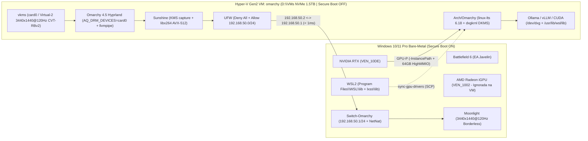

# omarchy-hyperv — Omarchy (Arch + Hyprland) no Hyper-V com GPU-P NVIDIA + Windows Bare-Metal

Automação pessoal para provisionar e operar uma **VM Linux Omarchy (Arch Linux + Hyprland)** no **Hyper-V (Windows 10/11 Pro)** com **GPU Paravirtualization (GPU-P)** usando exclusivamente a GPU **NVIDIA RTX (`VEN_10DE`)**, mantendo:

- **Windows bare-metal com Secure Boot ativo** — 100% compatível com anti-cheats em nível de kernel (validado rodando *Battlefield 6* / EA Javelin simultaneamente com a VM enxergando a RTX via GPU-P);
- **WSL2 ativo** — coexistindo normalmente e fornecendo os binários oficiais DXCore/D3D12/CUDA (`C:\Program Files\WSL\lib` + `C:\Windows\System32\lxss\lib`);
- **100% da experiência nativa do Omarchy 4.5** — temas, blur, Waybar, Walker e atalhos intactos via drop-ins isolados em **2K Ultrawide (`3440x1440 @ 120Hz/144Hz/165Hz`)**;
- **Sunshine + Moonlight** em **Borderless Fullscreen** sobre *Internal Virtual Switch* dedicado (`192.168.50.0/24`, latência `< 1ms`) com firewall UFW restrito à sub-rede interna.

> **Hardware validado em produção:** Windows 10/11 Pro bare-metal (Secure Boot ON) · AMD Ryzen 9 9950X (16c/32t, `16 vCPUs` na VM) · 96 GB RAM (Dinâmica `16 GB` startup / `4 GB` min / `64 GB` max) · NVIDIA GeForce RTX 5070 Ti (`VEN_10DE&DEV_2C05`, CUDA 13.3, driver `nvmdi.inf`, `64 GB` HighMMIO) ignorando iGPU AMD (`VEN_1002`) · Partição NVMe dedicada `D:\` (`1500 GB` VHDX dinâmico).

---

## Arquitetura



> **Por que Hyprland/Sunshine rodam em `llvmpipe`/`libx264` (CPU AVX-512) enquanto CUDA roda 100% na RTX?**
> O `/dev/dxg` (Hyper-V GPU-P) não é um render node DRM/GBM (`/dev/dri/renderD128`) para o Aquamarine/vkms. Isolar o compositor e o Sunshine em `llvmpipe` nos 16 vCPUs do 9950X elimina falhas de `gbm_bo_create` (`bo null`) e `EGL_EXT_image_dma_buf_import`, garante **100% da RTX dedicada para CUDA/LLMs na VM** e ainda deixa o Omarchy responsivo **mesmo com jogos pesados ocupando 90%+ da RTX no Windows**.

---

## Estrutura do Repositório

```text
omarchy-hyperv/
├── .env.example                 # Variáveis centralizadas (copiar para .env — ignorado no Git)
├── .gitignore
├── LICENSE                      # MIT
├── windows/
│   ├── common.ps1               # Helpers PowerShell (.env, logs, SSH, Invoke-NativeCapture)
│   └── 01-create-vm.ps1         # Provisionamento idempotente da VM em D:\ + Rede + GPU-P
├── linux/
│   ├── 02-setup-omarchy.sh      # [PRINCIPAL] Integração isolada para Omarchy / Arch Linux
│   ├── set-ultrawide.sh         # Alterna 3440x1440 entre 120Hz / 144Hz / 165Hz (CVT-RBv2)
│   └── 02-setup-vm.sh           # Alternativa para Ubuntu 24.04 LTS (linux-azure)
├── sync/
│   ├── sync-gpu-drivers.ps1     # Sync contínuo de drivers NVIDIA via PowerShell (Windows Host)
│   └── sync-gpu-drivers.sh      # Sync contínuo de drivers NVIDIA via Bash (WSL2)
├── gaming/
│   └── toggle-game-mode.ps1     # Alternância rápida Modo IA <-> Modo BF6 (VRAM + Moonlight + Save-VM)
└── README.md
```

---

## Isolamento Total no Omarchy (O que o Winix cria)

O script [linux/02-setup-omarchy.sh](linux/02-setup-omarchy.sh) **não sobrescreve** temas, blur, Waybar, Walker ou atalhos do Omarchy e respeita o hook de upgrade nativo (`omarchy update`). Todas as alterações ficam em arquivos isolados:

| Camada | Arquivo Isolado | Função |
| :--- | :--- | :--- |
| **Kernel GPU-P** | `dxgkrnl` (DKMS direto de `microsoft/WSL2-Linux-Kernel`) + `/etc/modules-load.d/99-winix-gpup.conf` | Compila `dxgkrnl` para `linux-lts` (ex.: `6.18.x` ↔ `linux-msft-wsl-6.18.y`), carrega `dxgkrnl` + `vkms` e define `linux-lts` como `default_entry` no `/boot/limine.conf` |
| **Permissão GPU** | `/etc/udev/rules.d/99-winix-dxg.rules` | `/dev/dxg` restrito ao grupo `render` (`0660`) |
| **Bibliotecas CUDA** | `/etc/ld.so.conf.d/99-winix-wsl.conf` + `/etc/profile.d/99-winix-gpup.sh` | Expõe `/usr/lib/wsl/lib` (`nvidia-smi` + `libcuda.so`) |
| **UWSM / Aquamarine** | `~/.config/environment.d/90-winix-vkms.conf` + `~/.config/uwsm/env-hyprland` | Trava `AQ_DRM_DEVICES=/dev/dri/card0` (evita bug `multigpu` entre `vkms` e `hyperv_drm`), `AQ_NO_MODIFIERS=1`, `LIBGL_ALWAYS_SOFTWARE=1`, `GALLIUM_DRIVER=llvmpipe` |
| **Monitor Ultrawide** | `~/.config/hypr/monitors.lua` *(Omarchy 4.5+)* | Configura `Virtual-2` em `3440x1440@120Hz` (modeline VESA CVT-RBv2), `scale = 1`, `GDK_SCALE = 1`, `WLR_NO_HARDWARE_CURSORS = 1` |
| **Anti-tela-preta** | `~/.config/systemd/user/hypridle.service -> /dev/null` | Impede `dpms off` no monitor virtual `vkms` (o Windows Host já gerencia o standby do monitor físico) |
| **Sunshine** | `~/.config/sunshine/{sunshine.conf,apps.json}` + `~/.config/systemd/user/sunshine.service` | `capture = kms`, `encoder = software` (AVX-512), `csrf_allowed_origins`, `GALLIUM_DRIVER=llvmpipe` isolado no serviço |
| **Rede Estática** | `/etc/systemd/network/10-winix-hyperv.network` | IP `192.168.50.2/24`, Gateway `192.168.50.1`, DNS `1.1.1.1` / `9.9.9.9` |
| **Segurança** | `/etc/ssh/sshd_config.d/99-winix-security.conf` + `ufw` + `/etc/sudoers.d/99-winix-ops` | `PermitRootLogin no`, UFW `default deny` liberando SSH/Sunshine apenas para `192.168.50.0/24`, sudoers mínimo (`ldconfig` e `systemctl ollama`) |

---

## Checklist de Pré-Requisitos (Windows Host)

- [ ] **Windows 10/11 Pro (64-bit)** com **Secure Boot ativo** na BIOS/UEFI (não altere o Secure Boot do host).
- [ ] **Hyper-V habilitado** (`Microsoft-Hyper-V-All` ativo e serviço `vmms` rodando).
- [ ] **WSL2 atualizado** (`wsl --update`) + **Driver NVIDIA** instalado no Windows (garante `C:\Program Files\WSL\lib` e `C:\Windows\System32\lxss\lib`).
- [ ] **Partição NVMe dedicada `D:\`** montada (ex.: `D:\VMs\omarchy` e `D:\isos\`).
- [ ] **ISO do Omarchy** salva em `D:\isos\` *(o script detecta automaticamente qualquer `omarchy*.iso`)*.
- [ ] **OpenSSH Client** ativo no Windows e **Moonlight** instalado:
  ```powershell
  winget install -e --id MoonlightGameStreamingProject.Moonlight
  ```
- [ ] **Criar seu `.env` local** (este arquivo fica no `.gitignore`):
  ```powershell
  Copy-Item .env.example .env
  notepad .env   # Ajuste VM_USER para o nome de usuário que criará no Omarchy
  ```

---

## Passo 1 — Criar a VM e Instalar o Omarchy

Em um **PowerShell como Administrador** na raiz do repositório:

```powershell
Set-ExecutionPolicy -Scope Process -ExecutionPolicy Bypass
.\windows\01-create-vm.ps1 -AttachInstallSwitch -StartVM
```

O `-AttachInstallSwitch` adiciona temporariamente o `Default Switch` (DHCP) para a instalação online do Omarchy funcionar sem configuração manual de rede. Instale o Omarchy normalmente na janela do `vmconnect`.

> **Nota sobre LUKS:** A ISO oficial do Omarchy usa criptografia LUKS — ao ligar a VM, abra `vmconnect localhost omarchy` apenas para digitar a senha do disco e depois feche o `vmconnect` e trabalhe 100% pelo Moonlight.

---

## Passo 2 — Setup Isolado dentro do Omarchy

1. **Dentro do Omarchy** (`Super + Return` no `vmconnect`), habilite SSH temporariamente e anote o IP `172.x.x.x`:
   ```bash
   sudo pacman -Sy --needed --noconfirm openssh
   sudo systemctl enable --now sshd
   sudo ufw allow 22/tcp
   ip -4 addr show | grep inet
   ```
2. **No Windows (PowerShell)**, envie o repositório para a VM *(troque `<USER>` e `<IP_TEMP>`)*:
   ```powershell
   scp -r . <USER>@<IP_TEMP>:~/omarchy-hyperv
   ssh <USER>@<IP_TEMP>
   ```
3. **Dentro da sessão SSH na VM**, atualize pelo canal oficial do Omarchy e execute o setup isolado:
   ```bash
   omarchy update
   chmod +x ~/omarchy-hyperv/linux/02-setup-omarchy.sh
   ~/omarchy-hyperv/linux/02-setup-omarchy.sh
   sudo poweroff
   ```
4. **No Windows (PowerShell Admin)**, remova o switch temporário de instalação e inicie a VM apenas no `Switch-Omarchy` (`192.168.50.2`):
   ```powershell
   .\windows\01-create-vm.ps1 -RemoveInstallSwitch -SkipISO -StartVM
   ```
   *(Desbloqueie o LUKS no `vmconnect` — o Limine já subirá automaticamente no kernel `linux-lts` com `/dev/dxg` e `vkms` ativos!)*

---

## Passo 3 — Chave SSH sem Senha e Sync de Drivers NVIDIA GPU-P

No **PowerShell do Windows** *(troque `<USER>` pelo seu `VM_USER`)*:

```powershell
# 1. Gere sua chave SSH (aperte Enter 3x se ainda não tiver id_ed25519)
ssh-keygen -t ed25519

# 2. Envie a chave pública para a VM (pede senha 1 única vez)
Get-Content "$env:USERPROFILE\.ssh\id_ed25519.pub" | ssh <USER>@192.168.50.2 "mkdir -p ~/.ssh && chmod 700 ~/.ssh && cat >> ~/.ssh/authorized_keys && chmod 600 ~/.ssh/authorized_keys"

# 3. Confirme kernel LTS + /dev/dxg + vkms
ssh <USER>@192.168.50.2 "uname -r && ls -la /dev/dxg && lsmod | grep -E 'dxgkrnl|vkms'"

# 4. Sincronize drivers NVIDIA (Program Files\WSL\lib + lxss\lib + DriverStore nv*) e valide nvidia-smi
.\sync\sync-gpu-drivers.ps1
```

*(Também existe a versão Bash para rodar de dentro do WSL2: `./sync/sync-gpu-drivers.sh`.)*
*(Opcional — Segurança máxima: após confirmar SSH sem senha, desative login por senha rodando na VM: `~/omarchy-hyperv/linux/02-setup-omarchy.sh --skip-network --disable-ssh-password`.)*

---

## Passo 4 — Pareamento Sunshine + Moonlight (`3440x1440 @ 120Hz`)

1. No navegador do Windows, abra **`https://192.168.50.2:47990`** *(aceite o aviso de certificado autoassinado)* e crie o login do Sunshine.
2. Abra o **Moonlight** → clique em **`+`** → informe **`192.168.50.2`**.
3. Clique no card **`omarchy`** → digite o **PIN de 4 dígitos** na aba **PIN** do Sunshine.
4. Na engrenagem de **Configurações do Moonlight**, use exatamente:

| Configuração Moonlight | Valor Recomendado |
| :--- | :--- |
| **Resolution** | **`3440x1440`** *(evita bordas pretas / windowboxing de 16:9)* |
| **FPS** | **`120`** *(equilíbrio ideal fluidez/temperatura; casa 1:1 com `Virtual-2`)* |
| **Video bitrate** | **`120–150 Mbps`** (Switch interno `< 1ms`) |
| **Display mode** | **`Borderless windowed`** |
| **V-Sync** | **Ativado** |
| **Frame Pacing (Ritmo do quadro)** | **Ativado** |
| **HDR** | **Desativado (OFF)** *(SDR 8-bit mantém cores e texto perfeitos)* |
| **Video codec** | **`Automatic`** ou **`H.264`** (`libx264` High 4:4:4 com AVX-512) |
| **Optimize mouse for Remote Desktop** | **Ativado** *(velocidade do mouse 1:1 idêntica ao Windows)* |
| **Capture system keyboard shortcuts** | **`Only in fullscreen`** |

5. Clique em **`Omarchy`** no Moonlight! *(Para alternar a VM entre `120Hz`, `144Hz` ou `165Hz` no futuro, rode na VM: `~/omarchy-hyperv/linux/set-ultrawide.sh 144`.)*

---

## Tabela de Atalhos (Moonlight vs. Omarchy)

### Moonlight (Escape para o Windows e Controle do Stream)

| Atalho | Ação |
| :--- | :--- |
| **`Ctrl + Alt + Shift + Z`** | **Libera mouse/teclado** para dar `Alt+Tab` e voltar ao Windows imediatamente |
| **`Ctrl + Alt + Shift + Q`** | Encerra a sessão de streaming |
| **`Ctrl + Alt + Shift + S`** | Exibe/oculta overlay de estatísticas (FPS, latência, bitrate) |
| **`Ctrl + Alt + Shift + X`** | Alterna tela cheia / janela |

### Principais Atalhos Nativos do Omarchy (Preservados 100%)

| Atalho | Ação |
| :--- | :--- |
| **`Super + Return`** | Abre terminal |
| **`Super + Space`** | Lançador de aplicativos (Walker) |
| **`Super + Alt + Space`** | Menu principal do Omarchy (Temas, Setup, Configs, Power) |
| **`Super + W`** | Fecha a janela ativa |
| **`Super + F`** | Alterna Fullscreen |
| **`Super + 1..9`** / **`Super + Shift + 1..9`** | Troca / move janela de Workspace |

---

## Passo 5 — Modo IA ↔ Modo BF6 (`toggle-game-mode.ps1`)

Antes de abrir jogos pesados como *Battlefield 6* no Windows bare-metal:

```powershell
# Descarrega 100% dos modelos da VRAM na VM (ollama stop) e fecha o Moonlight
.\gaming\toggle-game-mode.ps1 -Mode Game

# Opcional: apenas minimizar o Moonlight em vez de fechar
.\gaming\toggle-game-mode.ps1 -Mode Game -MinimizeOnly

# Opcional (Admin): Save-VM (-SuspendVM) ou desligamento gracioso (-StopVM)
.\gaming\toggle-game-mode.ps1 -Mode Game -StopVM

# Voltar ao Modo IA (garante VM ativa e reabre o Moonlight)
.\gaming\toggle-game-mode.ps1 -Mode AI

# Toggle automático
.\gaming\toggle-game-mode.ps1
```

---

## Troubleshooting Rápido (Lições Validadas em Produção)

| Sintoma | Causa / Solução |
| :--- | :--- |
| `nvidia-smi` retorna `Failed to initialize NVML: N/A` | Verifique se `/usr/lib/wsl/lib` contém `libdxcore.so` (de `C:\Program Files\WSL\lib`) e os loaders originais de `C:\Windows\System32\lxss\lib` (nunca sobrescreva com `.so` brutos do DriverStore). Re-execute `.\sync\sync-gpu-drivers.ps1`. |
| `/dev/dxg` não existe após reboot | Confirme `uname -r` termina em `-lts`. Se o Limine subiu no kernel `linux-omarchy`, confira `default_entry` no `/boot/limine.conf` apontando para `//linux-lts`. |
| `CSRF Protection Error` na Web UI do Sunshine | Confirme `csrf_allowed_origins = https://192.168.50.2:47990` em `~/.config/sunshine/sunshine.conf` e reinicie o Sunshine. |
| Tela congelada no logo do Omarchy (Plymouth) ou `GBM: bo null` | Confirme `~/.config/uwsm/env-hyprland` tem `AQ_DRM_DEVICES=/dev/dri/card0`, `AQ_NO_MODIFIERS=1`, `LIBGL_ALWAYS_SOFTWARE=1`, `GALLIUM_DRIVER=llvmpipe` (evita `multigpu` entre `vkms` e `hyperv_drm`). |
| Tela preta no Moonlight após ficar ocioso | O `hypridle` disparou `dpms off` no monitor virtual `vkms`. Confirme `~/.config/systemd/user/hypridle.service -> /dev/null` e reinicie o SDDM (`sudo systemctl restart sddm`) ou a VM. |
| Bordas pretas nos 4 lados em Ultrawide | Troque a **Resolution** nas configurações do **Moonlight** de `1080p`/`1440p` (16:9) para **`3440x1440`** (21:9). |
| `Save-VM` falha com `-SuspendVM` | Limitação do Hyper-V com GPU-P anexado. Use `-StopVM` para liberar 100% da RAM ou use `-Mode Game` sem `-SuspendVM` (VRAM já é 100% liberada). |
